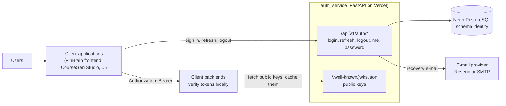
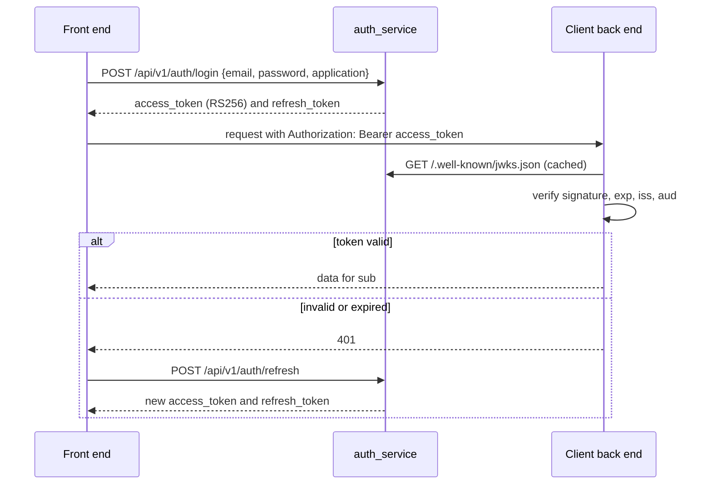
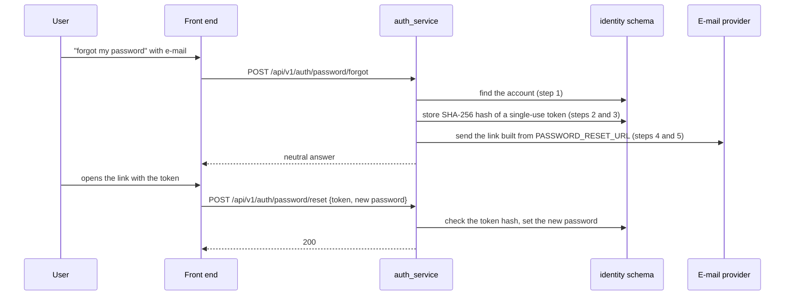
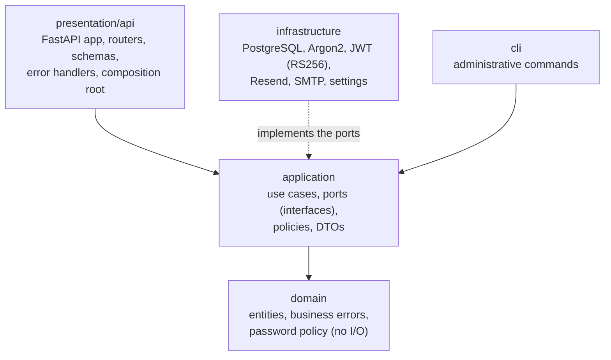
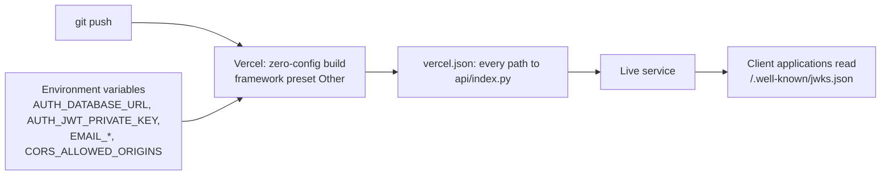

# Auth Service

Generic authentication and password management service, built with
FastAPI and deployed on Vercel. Any application (CourseGen Studio, and
future SynapseAI apps) signs its users in here and trusts the access
tokens it issues. Accounts live in the `identity` schema of the Neon
PostgreSQL database.

Interactive documentation, once the service is running:

- Swagger UI: `/docs`
- ReDoc: `/redoc`
- OpenAPI document: `/openapi.json`

## Contents

- [Overview](#overview)
- [Endpoints](#endpoints)
- [How client applications use it](#how-client-applications-use-it)
- [Password recovery](#password-recovery)
- [Security measures](#security-measures)
- [Architecture](#architecture)
- [Setup](#setup)
- [Logs](#logs)
- [Quality checks](#quality-checks)
- [Deploy on Vercel](#deploy-on-vercel)

## Overview



Only this service holds the private signing key. Client applications receive
access tokens and check them with the public keys, so they can trust the
tokens without being able to create new ones.

## Endpoints

| Method | Path | Auth | Purpose |
|--------|------|------|---------|
| GET | `/api/v1/health` | - | Liveness check |
| POST | `/api/v1/auth/login` | - | Sign in, returns access and refresh tokens. With `application`, the account must have access to it (`403` otherwise) |
| POST | `/api/v1/auth/refresh` | - | Rotate the refresh token, new access token |
| POST | `/api/v1/auth/logout` | Bearer | End the current session |
| GET | `/api/v1/auth/me` | Bearer | The authenticated user (also checks the session is still open) |
| POST | `/api/v1/auth/password/forgot` | - | E-mail a single-use reset link (neutral answer) |
| POST | `/api/v1/auth/password/reset` | - | Define a new password with the reset token |
| POST | `/api/v1/auth/password/change` | Bearer | Change the password, ending the other sessions |
| GET | `/.well-known/jwks.json` | - | Public keys that verify the access tokens |

## How client applications use it

1. The front end signs the user in with `POST /api/v1/auth/login` and
   keeps the `access_token` and `refresh_token`.
2. It calls its own back end with `Authorization: Bearer <access_token>`.
3. The client back end verifies the token **locally** with the public key
   from `/.well-known/jwks.json` (cache it): signature (RS256), `exp`,
   `iss` = `AUTH_JWT_ISSUER` and `aud` = `AUTH_JWT_AUDIENCE`. The claims
   are `sub` (user id), `email`, `name`, `sid` (session id), `iat` and
   `exp`.
4. The client back end keeps its own profile data keyed by `sub`; it never
   reads the `identity` schema.



A local check does not see sign-outs until the access token expires (15
minutes by default). When that matters, call `GET /api/v1/auth/me` with the
token instead.

## Password recovery

The service has no public sign-up. Recovery is done through a single-use link
sent by e-mail. The answer to `forgot` is the same whether or not the e-mail is
registered.



## Security measures

- Passwords hashed with Argon2id, rehashed when parameters change.
- Short-lived RS256 access tokens; JWKS for verification with key ids
  (`kid`) to allow key rotation.
- Opaque refresh and reset tokens stored only as SHA-256 hashes; refresh
  tokens rotate on every use.
- Per-account lockout after repeated failed sign-ins, counted from the
  audit trail.
- Responses never reveal whether an e-mail is registered.
- Every sign-in, sign-out and password event is written to
  `identity.audit_log`.
- At runtime the service connects as `identity_app`, a role that can only
  read and write the rows of the `identity` schema and only append to the
  audit log.

## Architecture

Clean Architecture; dependencies point inwards only.



```text
src/auth_service/
├── domain/           Entities, business errors, password policy (no I/O)
├── application/      Use cases, ports (interfaces), policies, DTOs
├── infrastructure/   Adapters: PostgreSQL, Argon2, JWT (RS256), Resend, SMTP, settings
├── presentation/api  FastAPI app, routers, schemas, error handlers,
│                     dependency wiring (composition root)
└── cli/              Administrative commands
api/index.py          Vercel entry point
db/schema.sql         The identity schema
manage.py             Runs the administrative commands
```

## Setup

```bash
uv venv
uv pip install -r requirements-dev.txt
cp .env.example .env                                         # fill NEON_DATABASE_URL
uv run --no-project python manage.py generate-signing-key     # paste into .env
uv run --no-project python manage.py apply-schema             # writes AUTH_DATABASE_URL
uv run --no-project python manage.py create-user ana@example.com "Ana Lima" --password
uv run --no-project uvicorn api.index:app --reload
```

The service has no public sign-up endpoint: administrators create accounts
with `create-user`. Without `--password`, the user defines the password
through "forgot my password". With `EMAIL_BACKEND=console`, the recovery
e-mail (including the link) is printed to the log instead of being sent.
With `EMAIL_BACKEND=resend` the message is sent through the Resend API
(`RESEND_API_KEY` and a `RESEND_FROM` address on a domain verified in
Resend); with `EMAIL_BACKEND=smtp` it goes through an SMTP server.

Access to applications is granted per account. An application must exist
in `identity.applications` (`finbrain` is seeded), and then:

```bash
uv run --no-project python manage.py grant-access ana@example.com finbrain
uv run --no-project python manage.py grant-access ana@example.com finbrain --revoke
```

A client that sends `"application": "finbrain"` in the sign-in body gets a
token only when the account has active access to it. A revoked grant keeps
its row, so the history stays in `identity.user_applications`. Clients that
do not send `application` keep the previous behavior.

## Logs

Every request writes two lines to standard error (Vercel shows them in the
function logs): `Request <method> <path> from <client>` and `Response
<method> <path>: HTTP <status> in <ms>`. The query string is never logged.

The forgot-password flow logs each step with its result, for example
`Step 1/5 result: no account uses this e-mail`, `Step 2/5` (token created),
`Step 3/5` (committed), `Step 4/5` (e-mail built), `Step 5/5` (handed to the
sender). The sender logs the call to Resend or to the SMTP server, and the
message id or the error. Failed deliveries are logged with the traceback.

Logs never contain passwords, tokens, keys or the full e-mail address
(`mask_email` keeps only the first letter of the local part). With
`EMAIL_BACKEND=console` the message body is logged, including the reset link,
so use that backend only in development.

## Quality checks

```bash
uv run --no-project pytest -q
uv run --no-project pylint --rcfile=.pylintrc src api manage.py
uv run --no-project pylint --rcfile=tests/.pylintrc tests
```

The same checks run on GitHub Actions (`.github/workflows/ci.yml`) for
every push to `main` and every pull request.

## Deploy on Vercel

1. Import the repository in Vercel (framework preset: *Other*).
2. Set the environment variables from `.env.example`. Required:
   `AUTH_DATABASE_URL` (Neon pooled host), `AUTH_JWT_PRIVATE_KEY`,
   `PASSWORD_RESET_URL`, `CORS_ALLOWED_ORIGINS`, `EMAIL_BACKEND=resend` with
   `RESEND_API_KEY` and `RESEND_FROM` (or `EMAIL_BACKEND=smtp` with the
   `SMTP_*` values). Never set `NEON_DATABASE_URL` there.
3. Deploy. `vercel.json` routes every path to `api/index.py`.
4. Point each client application at
   `https://<auth-service-host>/.well-known/jwks.json`.


